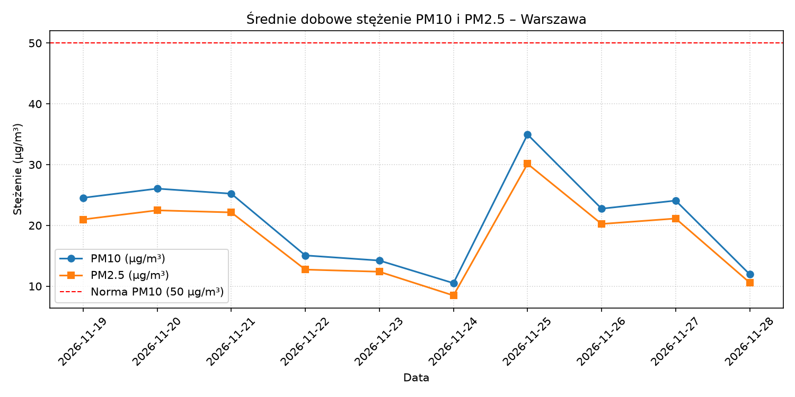

# Air Quality ETL & Data Quality Analyzer

Modułowy pipeline ETL w języku Python, który pobiera pobiera modelowane dane godzinowe o jakości powietrza (PM10, PM2.5, NO₂) z publicznego REST API, waliduje i czyści zbiór danych, zapisuje zdeduplikowane rekordy w bazie SQLite oraz generuje dzienne statystyki, analityczne raporty SQL i wykresy w Matplotlib.

## Przykładowa wizualizacja



## Główne funkcjonalności

- **Extract (Pobieranie):** Pobieranie godzinowych danych modelowych o jakości powietrza z publicznego REST API (`requests`) z obsługą parametrów zapytań i błędów.
- **Transform & Validate (Przetwarzanie i walidacja):** Wykorzystanie biblioteki `pandas` do wykrywania brakujących wartości i wartości nieprawidłowych (braki, ujemne), czyszczenia surowych danych, oznaczania przekroczeń norm oraz obliczania dziennych agregacji.
- **Load & Persist (Zapis danych):** Zapisywanie zdeduplikowanych rekordów w lokalnej bazie SQLite (`database.py`) oraz eksport oczyszczonych danych, statystyk dobowych i raportów jakości danych do plików CSV i JSON.
- **Analityka SQL:** Zestaw zapytań analitycznych (`queries.sql`) wykorzystujących `GROUP BY`, `CASE WHEN`, `HAVING`, CTE (`WITH`) oraz funkcje okna (`ROW_NUMBER()`).
- **Wizualizacja:** Generowanie wykresów dziennych trendów PM10 i PM2.5 wraz z linią normy dobowej za pomocą `Matplotlib` (`visualizer.py`).

## Źródło danych

Dane pochodzą z [Open-Meteo Air Quality API](https://open-meteo.com/en/docs/air-quality-api).
Są to **modelowane wartości** z europejskiej prognozy jakości powietrza
CAMS (Copernicus Atmosphere Monitoring Service, ok. 11 km), a nie pomiary
z lokalnych stacji. Dane CAMS dostarcza Open-Meteo (licencja CC BY 4.0).

## Technologie

- **Język:** Python 3
- **Przetwarzanie i wizualizacja danych:** `pandas`, `matplotlib`
- **API i przechowywanie danych:** `requests`, `sqlite3`, JSON, CSV
- **Analityka:** SQL (SQLite)

## Struktura projektu

```text
air-quality-etl/
├── main.py             # Główny plik uruchamiający pipeline ETL
├── api_client.py       # Pobieranie danych z Open-Meteo Air Quality API
├── config.py           # Miasta (współrzędne), adres API, normy jakości powietrza
├── processor.py        # Walidacja, czyszczenie danych i agregacje dobowe (pandas)
├── database.py         # Schemat SQLite, zapis bez duplikatów, zapytania podsumowujące
├── visualizer.py       # Wykresy Matplotlib (uruchamiany osobno)
├── queries.sql         # Analityczne zapytania SQL (CASE WHEN, HAVING, CTE, funkcje okna)
├── requirements.txt    # Zależności projektu
├── .gitignore
└── output/             # Raporty CSV/JSON, wykresy PNG (baza .db jest ignorowana przez git)

## Instalacja i uruchomienie

```bash
git clone https://github.com/zuzanna77/air-quality-etl.git
cd air-quality-etl
python -m venv .venv
.venv\Scripts\activate        # Windows (macOS/Linux: source .venv/bin/activate)
pip install -r requirements.txt

python main.py                # pobranie, czyszczenie, zapis (CSV, JSON, SQLite)
python visualizer.py          # wykresy dla wszystkich miast zapisanych w bazie
```

Zapytania analityczne uruchomisz np. poleceniem
`sqlite3 output/air_quality.db < queries.sql`
lub w programie DB Browser for SQLite.

## Dane wyjściowe (`output/`)

- `<miasto>_cleaned.csv` - oczyszczone dane godzinowe
- `<miasto>_daily_stats.csv` - statystyki dobowe i przekroczenia norm
- `<miasto>_quality_report.json` - raport jakości danych
- `<miasto>_air_quality.png` - wykres (po uruchomieniu `visualizer.py`)
- `air_quality.db` - baza SQLite (tabela `measurements`, klucz unikalny: miasto + czas)